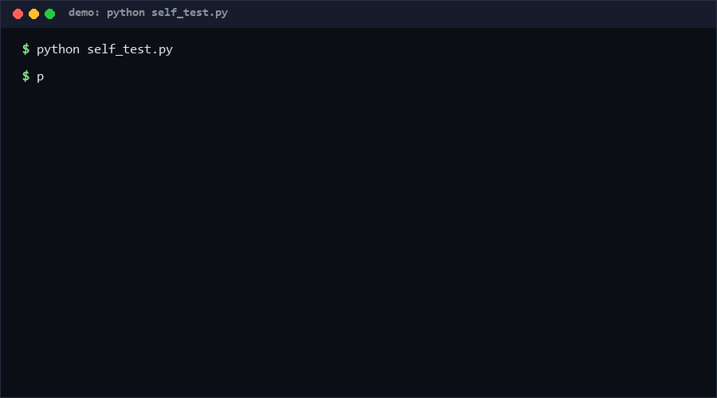

# scam-readme-fingerprint

A defensive static auditor that fingerprints malicious READMEs — the "README-as-attack-payload" pattern — using three signature families: loader IOC strings (download-and-execute chains), antivirus-suppression language, and SEO-stuffing structure. Point it at a folder of cloned repos and get a per-file verdict; everything is regex on text, nothing is ever fetched or run.

**Confidence: High (85%)** that the three-family model catches the batch-produced scam README template pattern; **Medium (60%)** that the default SEO threshold suits your corpus — tune `--seo-threshold` per batch [estimated].

<p align="center"></p>

## Problem

A growing batch-abuse pattern (documented in 2026 campaign observations, as of 2026-10-11) clones the identity of legitimate desktop tools, fills the README with SEO Q&A bait aimed at both search engines and LLM retrieval, then instructs users to pipe a remote `Loader.ps1` into `iex` — and pre-answers "antivirus flagged it?" with instructions to disable protection. Human reviewers scanning dozens of these miss the one changed URL. The detection is mechanical: the templates reuse the same three structural ingredients.

- **Why novel:** existing scanners target binaries and scripts; the README itself is treated as inert marketing. Here it is the attack surface.
- **Overlooked angle:** the same template features that bait humans bait retrieval-augmented agents — an agent that "reads the docs" inherits the malicious install command. Static fingerprinting protects both audiences.

## How it works

| Family | What it matches | Verdict impact |
|---|---|---|
| A — loader IOCs | `irm https://…/Loader.ps1 \| iex`-style chains, `curl…\|sh`, `powershell -enc`, direct `.ps1/.bat` URLs, configured signature host strings (e.g. `ps-ps.cc`, a static IOC string — never contacted) | CRITICAL |
| B — AV suppression | "disable real-time protection", "add an exclusion", "AV may flag this — ignore it" | HIGH |
| C — SEO stuffing | Q&A-header piles + scam-keyword density (free/crack/license key/…) above a threshold | MEDIUM |
| none of the above | — | CLEAN |

Any family-A hit dominates the verdict; families combine per file. Scan files or whole directory trees (`README*`, `*.md`, `*.txt`). Exit codes: 0 = all CLEAN, 1 = any flag. Reports are JSON or human-readable, with matched snippets truncated to 80 chars.

## Quickstart (~2 min)

```bash
# 1. Self-test: 21 checks, functional / error-path / extreme-edge (~2 s)
python self_test.py

# 2. Demo: two embedded synthetic fixtures (malicious pattern vs benign) (~1 s)
python cli.py demo

# 3. Scan real files you have already cloned
python cli.py scan ~/cloned_repos/ --report audit.json
python cli.py scan some_readme.md --json
```

## Why not X

| Alternative | Why not |
|---|---|
| VirusTotal / URL scanners | Need the live URL or binary — which this tool deliberately never touches; also leaks potentially sensitive audit targets to a third party |
| GitHub's own malware detection | Catches repos flagged at scale, slowly; this runs per-batch on your local clones in seconds and explains *which* signature matched |
| LLM-based README review | Non-deterministic, per-page cost, and an adversarially written README is literally optimized to persuade LLMs; fixed regexes can't be sweet-talked |
| YARA rules | Right idea, wrong layer: YARA targets binary/file structure; this is tuned for markdown structure (headers, prose phrasing) with zero rule-compilation setup |

## Minimal Fallback (PLAN B)

No Python? The three signatures fit in one `grep -riE "irm .*iex|add an exclusion|disable.*defender" folder/` — that one-liner catches the highest-signal pair (loader chain + AV suppression). The JSON report schema in this README is the contract for any re-implementation.

## Ethics & Legal Boundaries

This is a **defensive audit tool**, and its boundaries are part of the design:

1. **No network.** No socket, no HTTP client anywhere in the codebase. IOC host strings (like the one named above) are *static signatures for string matching only* — they are never resolved, contacted, or fetched. Cloning suspicious repos for scanning is the operator's action, done with their own tooling and judgment.
2. **No execution, no deactivation.** Malicious instructions found in scanned text are reported as inert matched strings, truncated to 80 characters. The tool never executes payloads, never disables or configures security software, and never modifies scanned files.
3. **Detection, not retaliation.** Output supports reporting repos to hosting platforms and warning users. It does not support doxxing repo owners, scanning private/personal data beyond the README/markdown scope you point it at, or automating takedowns.
4. **False positives are expected.** A legitimate README that quotes a malicious command (security write-ups, CTF notes) will match family A. The report shows matched text so humans make the final call — this tool ranks suspicion, it does not convict.

## Design Trade-offs

Priority order: **zero side effects > recall of batch templates > per-repo nuance**. Static regex over learned classifiers trades adaptability for determinism, auditability, and zero network/ML dependencies — an auditor you can read in one sitting. Signature hosts are a curated list, not a live feed, so it ages; the list format makes updating it a one-line diff. SEO stuffing is scored (headers + keywords) rather than binary because marketing-heavy-but-legitimate repos sit near the line; the threshold is exposed, not hidden.

## Limits & Second-order Effects

- Template drift: once this class of detector spreads, next-generation scam READMEs will paraphrase AV language and obfuscate URLs (base64, shorteners) — family A needs periodic pattern review, family C is the most drift-resistant.
- Base64/encoded payloads inside README code blocks will not decode here; encoded loaders are invisible to v0.1 (adding decoding would expand the execute-adjacent surface we deliberately avoid).
- If batch auditors rely on this tool alone, attackers optimize against the regexes (Goodhart); use it as a triage layer feeding human review, not as the verdict.
- Flagging legitimate security education content is a real cost; the matched-snippet report exists to keep humans in the loop.

## FAQ

**Can this tool hurt me if I scan a malicious README?** No. Matching is pure string operations on text you already have on disk. The tool never visits the URLs it finds.

**It flagged a README I wrote documenting an attack. Why?** Family A matches quoted loader commands regardless of intent — that's the documented false-positive class. Read the matched snippets; a report is a hypothesis, not a judgment.

**When NOT to use this?** Don't use it as your only malware defense (it reads prose, not binaries — an infected repo with a clean README sails through). Don't use it on content you haven't legally obtained (scan repos you cloned for audit purposes). And don't use it to auto-delete or auto-report without human review; the whole design assumes a human reads the report.

**Why is the IOC host list hardcoded instead of fetched from a feed?** A tool whose job is "never touch the network" cannot fetch feeds. Updates land as commits to the list — slower, but auditable and consistent with the boundary.

## [Core Assumptions]

1. The batch-abuse templates reuse structural ingredients (loader chain, AV-suppression prose, SEO pile) across repos, so a fixed signature set has durable recall on the *pattern* even as brand names rotate.
2. Operators clone audit targets themselves; this tool's scope starts at files already on disk.
3. Static matching with human review beats automated classification for adversarial text optimized to persuade models.
4. Naming one signature host as a static IOC string is proportionate defensive disclosure — it is already public in campaign reports and is never contacted by this tool.

*Data as of 2026-10-11. Measured: 21/21 self-test checks (~2 s) and the two-fixture demo, repro via `python self_test.py` / `python cli.py demo` on Windows 10 / CPython 3.11. Campaign-pattern observations are qualitative; threshold tuning guidance [estimated].*
